# Validation — 2026-10-26

Update **2.1.0**. Both builds use Temurin JDK 25.0.4.1.

| Minecraft | Loader | Gradle | Loom |
| --- | --- | --- | --- |
| 26.2 | 0.19.3 | 9.6.1 | 1.17.21 |
| 1.21.11 | 0.18.2 | 9.2.0 | 1.14.10 |

The 1.21.11 port uses its version-specific Meteor base and official mappings,
normal depth conventions, dedicated persistent sky buffers and adapted mixins.
The two client JARs and source ZIPs are separate. Java 25 is required by the
bundled integrations even though vanilla Minecraft 1.21.11 supports Java 21.

| Check | Result |
| --- | --- |
| Client build | `./gradlew build` passed |
| Unit tests | 31 tests in each version, zero failures/errors/skips: camera-frustum edge/rotation/large-coordinate tests, frame history, frame-rate-independent key fades, short taps, bounded click ripples, camera-angle wrapping/recentering, HUD docking, sky noise and quality budgets |
| Graphical integration | 222 successful checks with Glazed 26.2-n-17.2, Fabric API 0.161.0+26.2 and the separate example addon; `build/smoke/result.json` reports `passed: true` |
| 1.21.11 packaged runtime | 222 checks passed with the remapped release JAR, standard Fabric Knot launcher, Glazed 1.21.11-n-17.2, Fabric API 0.141.6+1.21.11 and a separately built example addon |
| 26.2 standalone integration | 204 checks passed without Glazed or full Fabric API (separate example retained) |
| 1.21.11 standalone packaged runtime | 204 checks passed with the separate example addon, without Glazed or full Fabric API |
| Mixin/shader initialization | No mixin audit/application errors or shader compilation failures in the final run |
| Main menu | Zenith is recognized as a TitleScreen; native GUI eligibility, return from theme settings and actual world disconnect retain the custom menu |
| Glazed compatibility | 80 external Glazed modules registered; all 240 settings screens opened across three themes; three external setting factories retained; Nora Deepslate and Zenith Aim Assist retained their separate class identities |
| Category pages | Next-page button displayed addon categories; visible windows did not overlap |
| Larger HUD | New size multiplier defaults to 2 on existing/new widgets; smooth rounded corners/line fringes; doubled-size docking tested at five resolutions |
| Sky source controls | Vanilla and Resource Pack stop Zenith sky/tint overrides; custom panorama submitted through ResourceManager; missing texture falls back |
| Sky stability | Rotation matrix has zero translation at all tested angles; before/after movement screenshots captured with procedural drift disabled. |
| Extra effects | All five new layers submitted geometry; zero strength and all individual toggles stopped extra submissions; Low/Balanced/High frame ceilings and disable cleanup passed. New geometry uses the existing depth-tested batches, with no added draw passes or persistent particle histories. |
| New motion layers | Crystal comet trails, falling blast showers and pearl arrival petals rendered. Strength, toggle and cleanup checks cover each new layer; all share the existing primitive allowance. |
| Overlapping blasts | Multiple simultaneous explosions reduce opacity; disabling softening restores full brightness. Geometry/particle limits remain enforced in Economy mode. |
| Visual polish | Shader-shaded faceted fragments and rotating energy blooms submitted; bloom toggle checked; crossed slashes use independent axes and shard rotation varies per particle. |
| Economy mode | Optional 96-spark / 8-burst / 64-extra-primitive budget, 833-vertex sky, 24-block range and shorter entity trails. Quality selection is retained and restored on exit. This is a workload limit, not a system-wide utilization cap. |
| Visibility optimization | In-game comparison checks visible crystal groups and sprite submissions with culling off/on, then turns the camera to reveal the opposite group. Unit tests retain edge-overlapping glows and camera-containing effects. |
| Cached sky geometry | Reference sky and custom panorama reuse GPU buffers across frames/camera rotation; quality changes rebuild topology; disable frees buffers and re-enable recreates them. |
| Render overhead | Scratch color buffers replace per-primitive Color allocations; dome circles and camera coordinates are reused; inactive weather/entity scans are skipped. No hardware utilization percentage claimed. |
| Soft effects | Analytic antialiased ring shader and radial/star light sprites rendered without shader compilation failures; batched draw retains world depth tests |
| New modules | All ten registered and opened in all three themes; real jump, health loss, attack, armor damage and camera changes exercised every module; bounded histories and disable cleanup passed |
| GUI animation controls | Motion speed, reduced motion, header motion and click-pulse settings registered and exercised; text batches retain their originating theme renderer |
| Three themes | Zenith 2.0 native categories, optional Dashboard, upstream Catppuccin and stock Meteor all rendered; selection persisted and legacy Zenith name migrated |
| Built-in Nora | 14 modules registered in this Meteor revision (Attribute Swap already exists in the base); all five commands registered; module settings retained Nora identity |
| Nora custom categories | Actual category buttons opened the editor from both native Meteor and Catppuccin settings screens |
| Cubiomes | Nested native dependency loaded on Linux; Windows DLL and macOS dylib are also present in the upstream dependency |
| Separate addon | External Fabric example registered its category/module, edited native settings and received real private Orbit tick events |
| Look Direction | Dot moved with yaw/pitch, stayed inside its circle, then returned to center without tracking other players |
| Key animation | W, jump, LMB and RMB press/release pairs between rendered frames illuminated their tiles and started independent ripples; release fades/ripples expired |
| HUD/world | Integrated flat world joined; eight editable widgets rendered; totem equipped; potion state and measured heap/frame history populated |
| Combat visuals | Confirmed hit, explosion and death events produced effects; crystals rendered; pearls accumulated trails and arrival pulses; native explosion clouds were replaced |
| Reference skies | Red dusk and silver storm captured; reference presets applied on selection and preserved manually edited values through save/load |
| Sky occlusion/cleanup | Opaque obsidian occluded the sky; Low/Balanced/High mesh and star ceilings verified; toggling off stopped rendering; disable/re-enable recreated sky resources |
| Silver rain | Cinematic rain replaced blue rain columns, drew white streaks/surface rings and restored previous local weather when disabled |
| Zenith combat modules | Local Kill Aura attack, Crystal Aura break, duplicate-engine exclusion and menu pause/resume passed |
| Packaging | Metadata, entrypoints, all listed mixins, Java bytecode target, addon/effect classes, shader resources, licenses and 14 (26.2) / 16 (1.21.11) nested JARs verified; smoke/example addon code excluded |

The controlled visibility scene places eight crystals ahead of the camera and
eight behind, using Balanced quality. Both runs recorded **16 → 8** rendered
crystal effect groups and **131 → 83** submitted glow sprites when culling was
enabled. Turning the camera revealed the other eight crystals. The reference sky
and custom panorama continued rendering with **zero geometry rebuilds** across
the stable-settings measurement intervals, including panorama camera rotation.
Changing quality rebuilt the panorama, and disable/re-enable released/recreated
the caches. `build/smoke/performance.json` records these render-work counts.

Both versions recorded the same culling counts shown above. Machine-readable
results are retained in [validation-2.1.0](validation-2.1.0/).

The graphical run uses Xvfb and Mesa llvmpipe software OpenGL. It establishes
startup and exercised rendering/input behavior, not a hardware FPS improvement or
pixel-identical reproduction of the recordings. Their original texture packs,
shader lighting, scene geometry and effect assets were not supplied. These are
new procedural effects based on the visible references.

Windows Command Prompt, online server combat, optional Baritone and optional
Sodium/Lithium combinations were not executed. The native Cubiomes test covers
Linux loading, not every world-generation result or native platform. Module
registration does not establish every inherited module's behavior on every server.
Expected unavailable audio/authentication/cape services and the Xvfb cursor warning
did not block the graphical checks.

Glazed is separately installed for compatibility testing and excluded from published bundles; Nora's upstream
`LegitMaceKill` is excluded for unverified borrowed-source licensing. Nora's
automatic identity/addon telemetry is omitted. See [source provenance](../third-party/README.md).

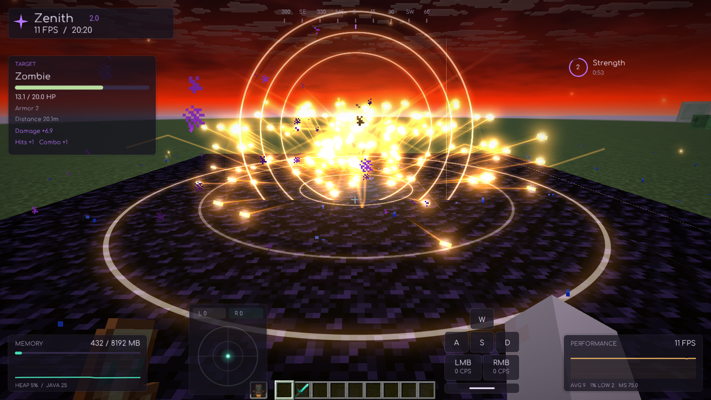

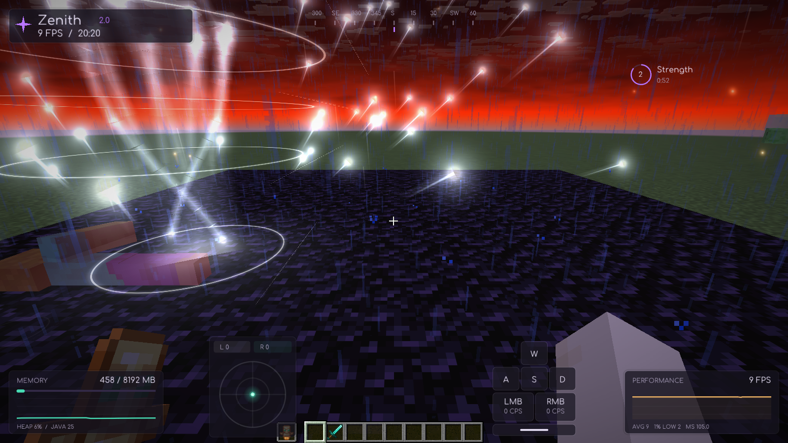

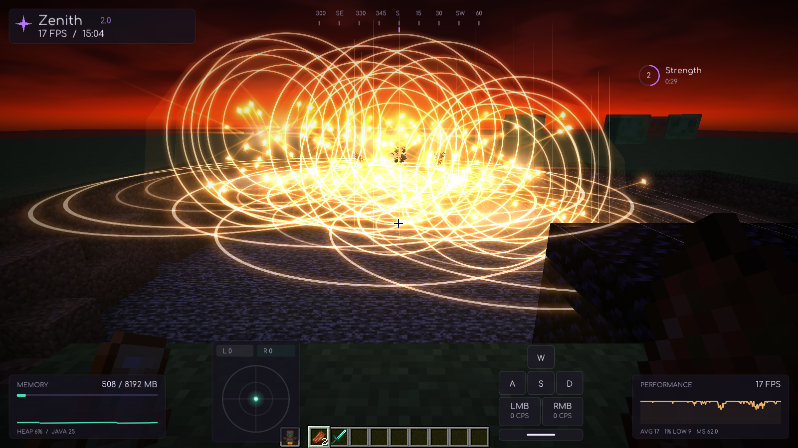

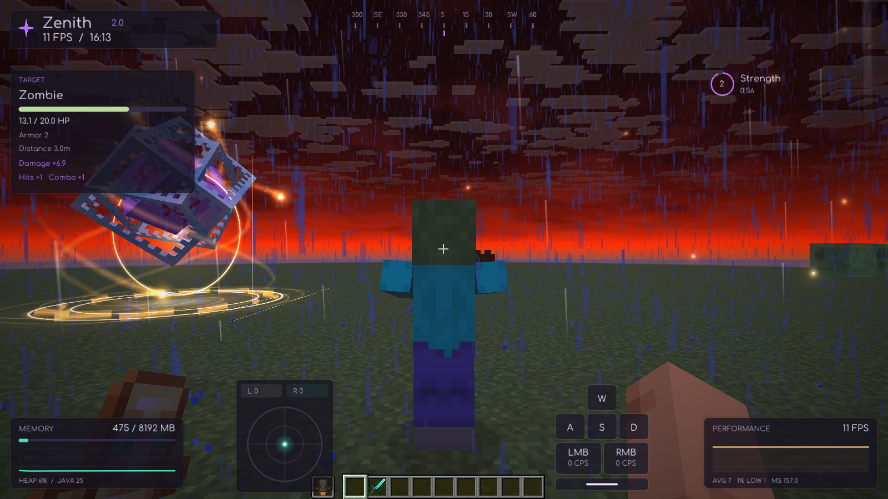

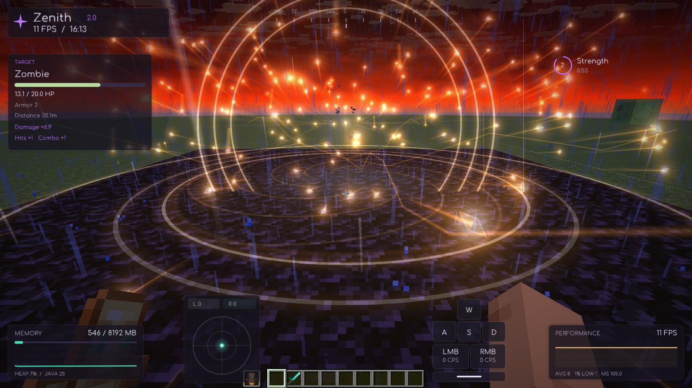

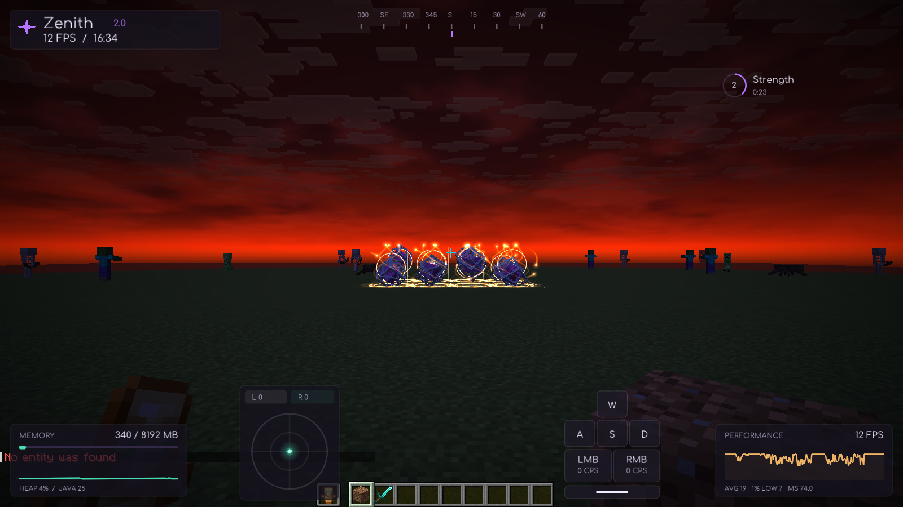

## Minecraft 1.21.11 captures

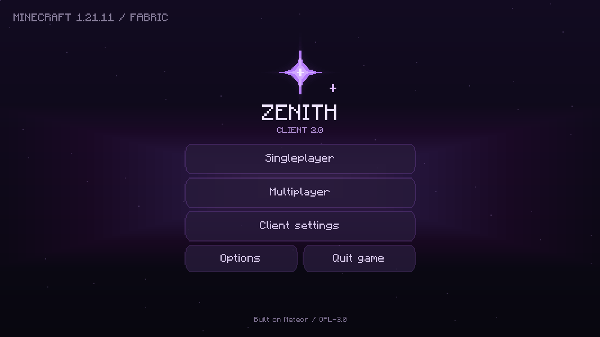

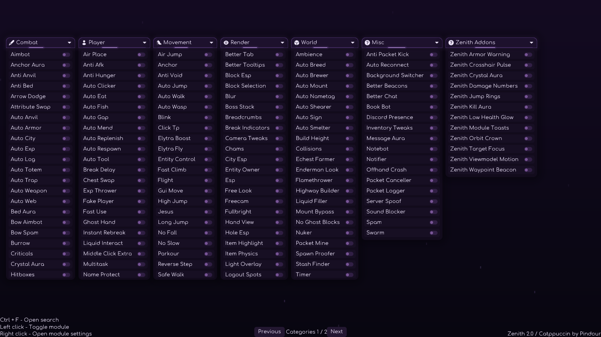

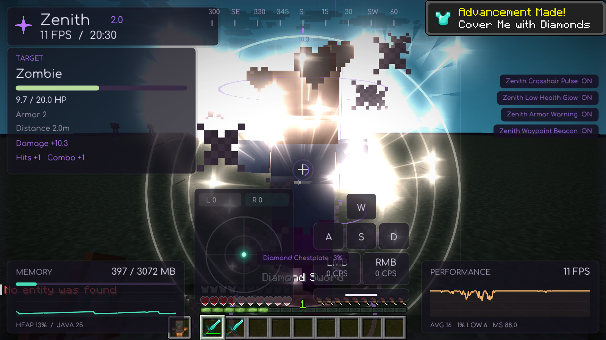

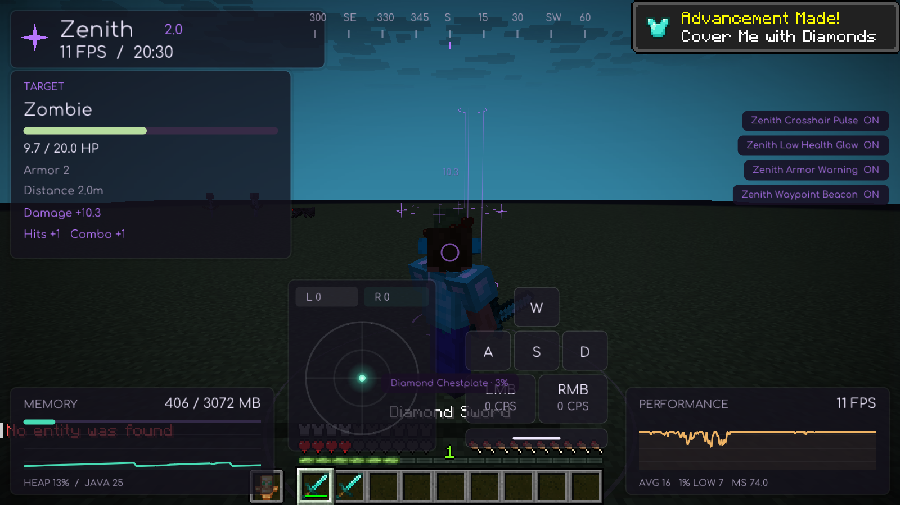

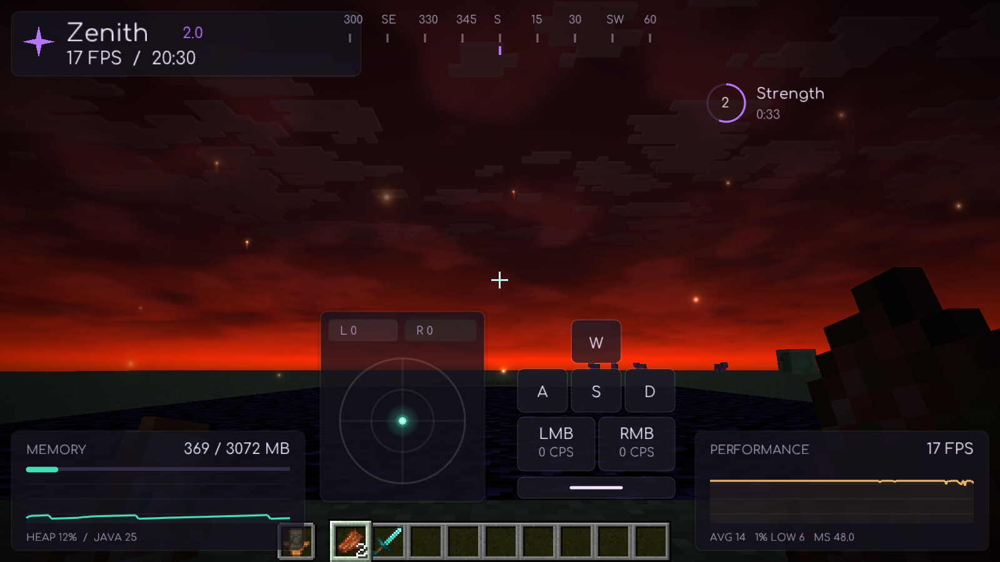
