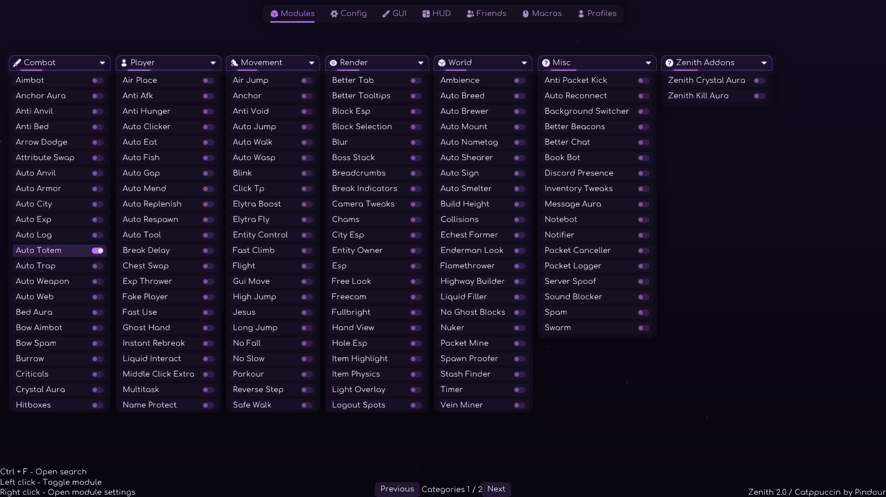
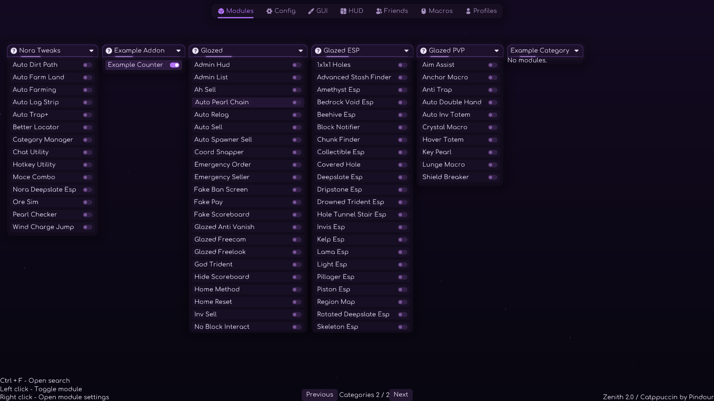
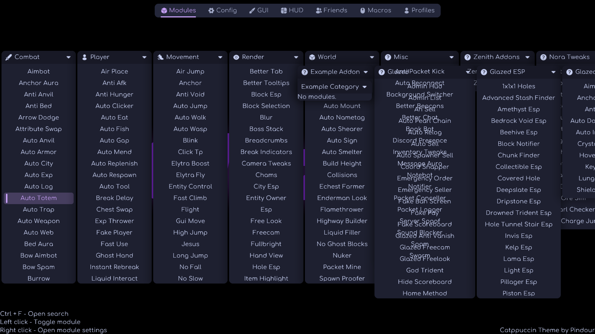
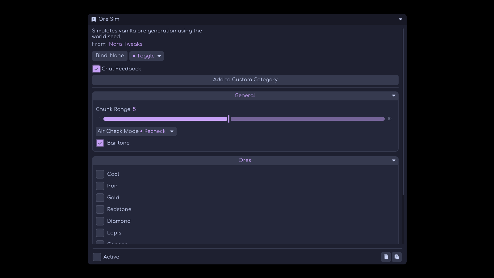
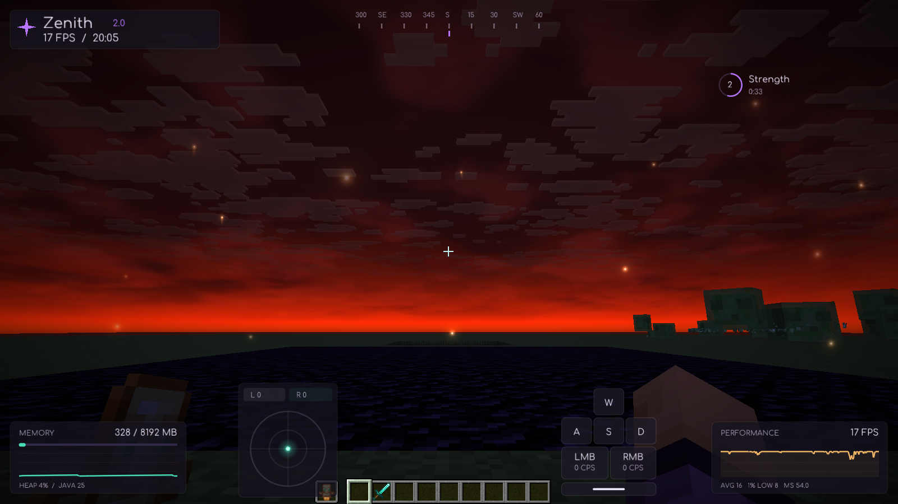
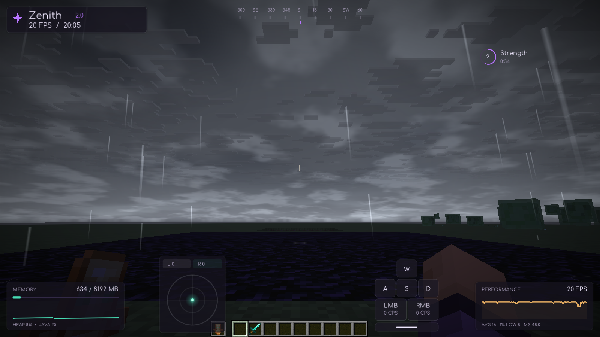
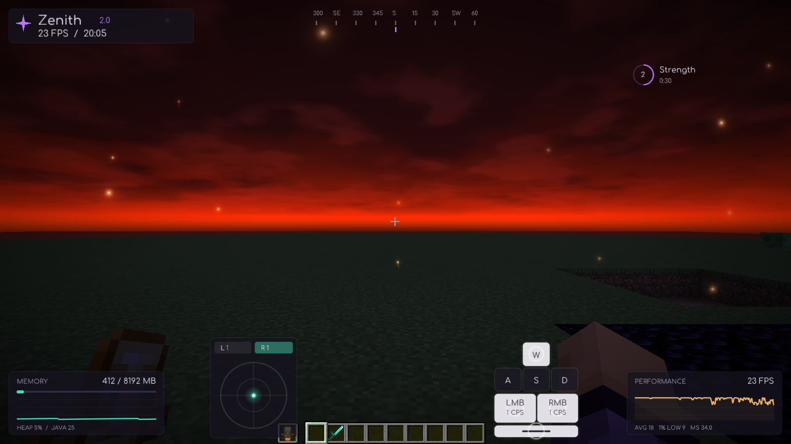
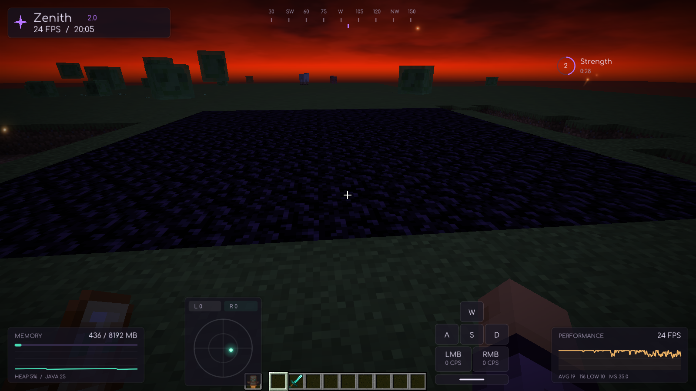
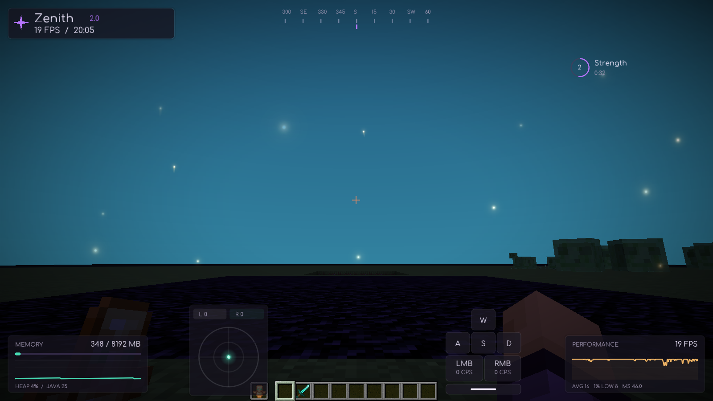
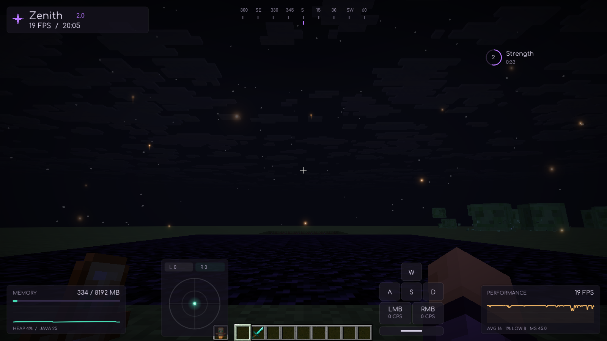

# Validation — 2026-10-21

Update **2.0.5**. Target: Minecraft 26.2, Fabric Loader 0.19.3, Temurin JDK
25.0.4.1, Gradle 9.6.1 and Fabric Loom 1.17.21.

| Check | Result |
| --- | --- |
| Client build | `./gradlew build` passed |
| Unit tests | 25 tests, zero failures/errors/skips: frame history, frame-rate-independent key fades, short taps, bounded click ripples, camera-angle wrapping/recentering, HUD docking, sky noise and quality budgets |
| Graphical integration | 137 successful checks with Glazed 26.2-n-17.2, Fabric API 0.161.0+26.2 and the separate example addon; `build/smoke/result.json` reports `passed: true` |
| Standalone integration | 118 checks passed with no Glazed or full Fabric API installed (separate example addon retained) |
| Mixin/shader initialization | No mixin audit/application errors or shader compilation failures in the final run |
| Main menu | Zenith is recognized as a TitleScreen; native GUI eligibility, return from theme settings and actual world disconnect retain the custom menu |
| Glazed compatibility | 80 external Glazed modules registered; all 240 settings screens opened across three themes; three external setting factories retained; Nora Deepslate and Zenith Aim Assist retained their separate class identities |
| Category pages | Next-page button displayed addon categories; visible windows did not overlap |
| Larger HUD | New size multiplier defaults to 2 on existing/new widgets; smooth rounded corners/line fringes; doubled-size docking tested at five resolutions |
| Sky source controls | Vanilla and Resource Pack stop Zenith sky/tint overrides; custom panorama submitted through ResourceManager; missing texture falls back |
| Sky stability | Rotation matrix has zero translation at all tested angles. A 600×100 sky patch before/after moving 8 blocks horizontally and 6 vertically had mean absolute channel differences below 0.03/255, with drift disabled; minor differences are animated foreground lights |
| Soft effects | Analytic antialiased ring shader and radial/star light sprites rendered without shader compilation failures; batched draw retains world depth tests |
| Three themes | Zenith 2.0 native categories, optional Dashboard, upstream Catppuccin and stock Meteor all rendered; selection persisted and legacy Zenith name migrated |
| Built-in Nora | 14 modules registered in this Meteor revision (Attribute Swap already exists in the base); all five commands registered; module settings retained Nora identity |
| Nora custom categories | Actual category buttons opened the editor from both native Meteor and Catppuccin settings screens |
| Cubiomes | Nested native dependency loaded on Linux; Windows DLL and macOS dylib are also present in the upstream dependency |
| Separate addon | External Fabric example registered its category/module, edited native settings and received real private Orbit tick events |
| Look Direction | Dot moved with yaw/pitch, stayed inside its circle, then returned to center without tracking other players |
| Key animation | W, jump, LMB and RMB press/release pairs between rendered frames illuminated their tiles and started independent ripples; release fades/ripples expired |
| HUD/world | Integrated flat world joined; eight editable widgets rendered; totem equipped; potion state and measured heap/frame history populated |
| Combat visuals | Confirmed hit, explosion and death events produced effects; crystals rendered; pearls accumulated trails and arrival pulses; native explosion clouds were replaced |
| Reference skies | Red dusk and silver storm captured; reference presets applied on selection and preserved manually edited values through save/load |
| Sky occlusion/cleanup | Opaque obsidian occluded the sky; Low/Balanced/High mesh and star ceilings verified; toggling off stopped rendering; disable/re-enable recreated sky resources |
| Silver rain | Cinematic rain replaced blue rain columns, drew white streaks/surface rings and restored previous local weather when disabled |
| Zenith combat modules | Local Kill Aura attack, Crystal Aura break, duplicate-engine exclusion and menu pause/resume passed |
| Packaging | Metadata, entrypoints, all listed mixins, Java bytecode target, addon/effect classes, shader resources, licenses and 14 nested JARs verified; smoke/example addon code excluded |

The graphical run uses Xvfb and Mesa llvmpipe software OpenGL. It establishes
startup and exercised rendering/input behavior, not a hardware FPS improvement or
pixel-identical reproduction of the recordings. Their original texture packs,
shader lighting, scene geometry and effect assets were not supplied. These are
new procedural effects based on the visible references.

Windows Command Prompt, online server combat, optional Baritone and optional
Sodium/Lithium combinations were not executed. The native Cubiomes test covers
Linux loading, not every world-generation result or native platform. Module
registration does not establish every inherited module's behavior on every server.
Expected unavailable audio/authentication/cape services and the Xvfb cursor warning
did not block the graphical checks.

Glazed is separately installed for compatibility testing and excluded from published bundles; Nora's upstream
`LegitMaceKill` is excluded for unverified borrowed-source licensing. Nora's
automatic identity/addon telemetry is omitted. See [source provenance](../third-party/README.md).

