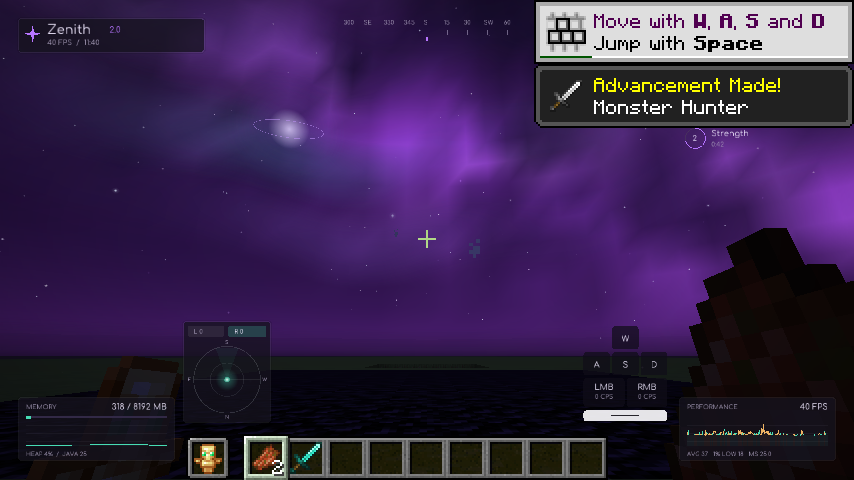
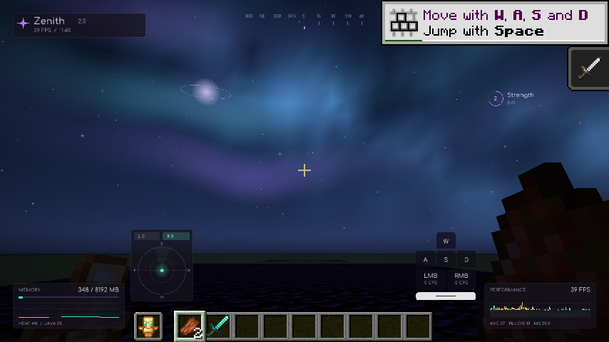
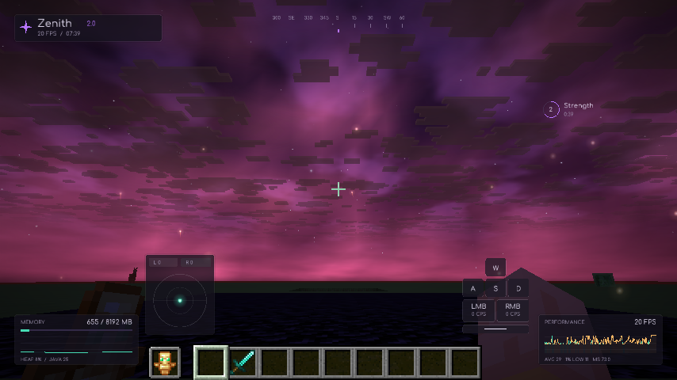
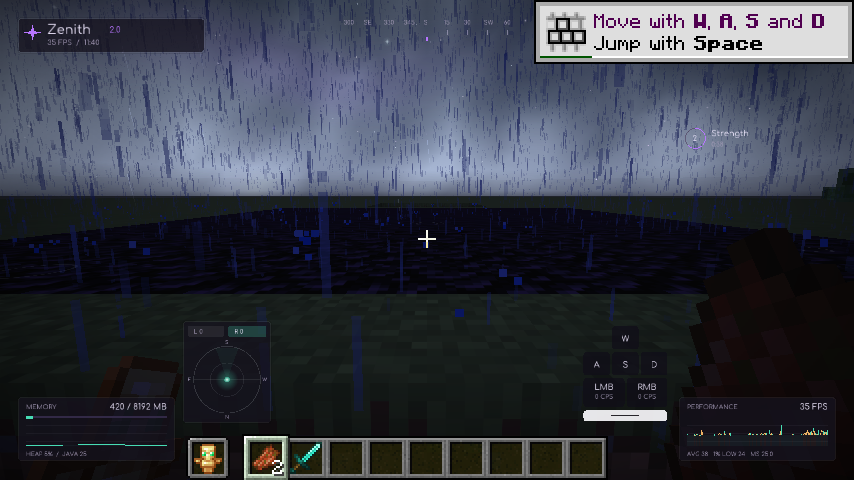
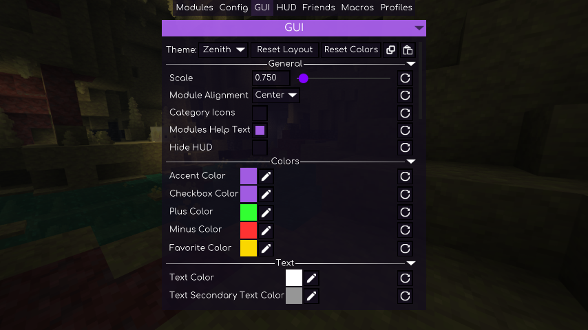
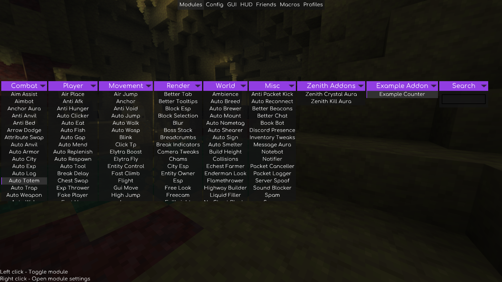
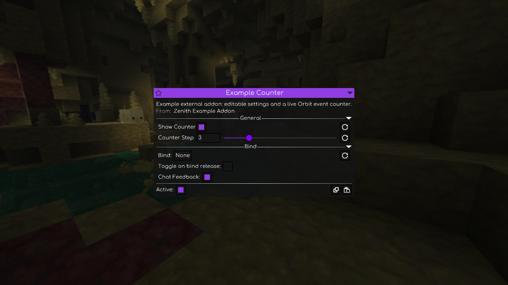

# Validation — 2026-10-20

Update: 2.0.3. Target: Minecraft 26.2, Fabric Loader 0.19.3, Temurin JDK 25.0.4.1,
Gradle 9.6.1 and Fabric Loom 1.17.21.

| Check | Result |
| --- | --- |
| Client build | `bash scripts/setup-cloud.sh` / `./gradlew build` passed |
| Frame history, animation, radar/docking, sky noise and quality budgets | 18 tests, 0 failures, 0 errors, 0 skipped |
| Graphical integration | 73 successful checks with the separate example addon loaded; `build/smoke/result.json` |
| Startup and mixins | Minecraft launched; development mixin audit completed |
| Menu, module UI, HUD editor | Rendered screenshots captured from Minecraft |
| Custom dashboard controls | Clicked enum, boolean and slider controls; searched and toggled a module; animated close completed |
| Meteor GUI mode | Native ModulesScreen, upstream scale/accent/background, theme selector, saved selection and return to Zenith verified |
| External addon build | Separate Fabric project compiled against the built client API; metadata uses the standard meteor entrypoint |
| External addon runtime | Category/module attributed to the addon; native settings editor and live private Orbit tick handler verified |
| Local world | Integrated flat world created and joined |
| Auto Totem | Supplied totem equipped in Strict mode |
| Potion HUD | Server potion state received and rendered |
| Memory/performance HUD | Real heap and frame samples recorded |
| Hit effects | Target health loss produced a hit burst |
| Crystals | Crystal corona geometry rendered |
| Pearls | Thrown pearl produced trail samples |
| Explosions/deaths | Server events produced their respective effect bursts |
| Expanded particles | Motion streaks, crossed hit arcs, crystal orbitals, blast filaments, death spirals and pearl arrival pulses rendered |
| Procedural sky | Nebula, Aurora and Cloudscape captured in Minecraft; native sky-pass shader compiled |
| Sky quality | All three mesh sizes and star limits checked; shooting stars submitted; toggle/cleanup verified |
| Terrain occlusion | Obsidian test column remains opaque in front of the procedural sky |
| Local weather | Cinematic rain rendered streaks/ripples; toggling it off restored prior rain/thunder levels |
| Explosion replacement | Native explosion clouds were intercepted while the golden effect rendered |
| Zenith Addons | Custom Kill Aura attacked a local zombie; Crystal Aura paused newly spawned crystals in menus and resumed to break one; both aura pairs excluded their duplicate engines |
| Radar and keys | Player face marker rendered; W/RMB press fills, purple pearl ribbon and in-tile CPS captured |
| Performance limits | Low/Balanced/High ceilings are 256/768/1,536 sparks; live downgrades trim active storage |
| JAR packaging | Metadata, entrypoints, mixins, 13 nested libraries, license, Java target and exclusion of the smoke addon verified |

The graphical checks use Xvfb and Mesa llvmpipe (software OpenGL). They validate
startup and rendering, not a hardware FPS comparison. Windows Command Prompt,
online multiplayer combat, and optional Sodium/Lithium combinations were not
executed here. These checks do not establish every inherited Meteor module's
behavior on every server.

The recordings and screenshot guided the layout and procedural effects. An exact
match to their texture packs, shader lighting and original assets has not been
established.

